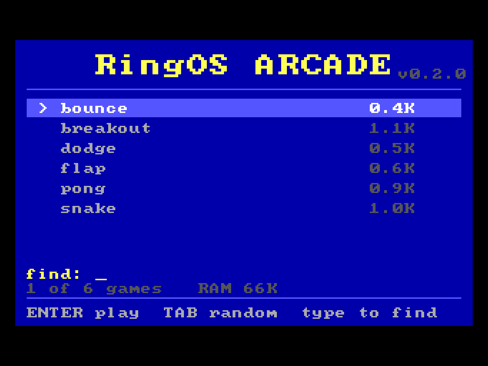
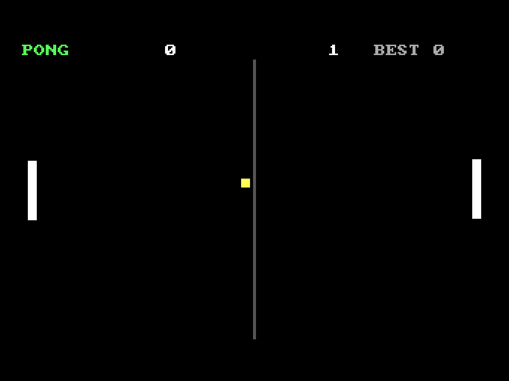
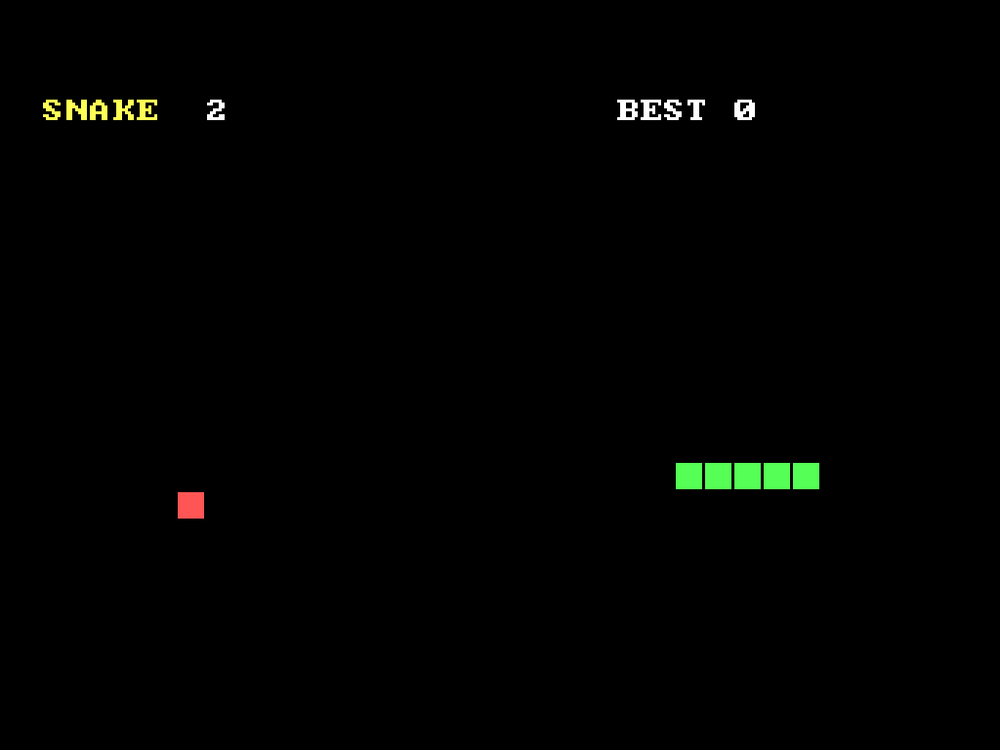

# RingOS

An arcade operating system, written in Rust, where games are written in **Ring**, a tiny language.
Boots from UEFI, shows a gallery of games, and runs them as sandboxed bytecode.
Every game gets a hard **16 KB** budget (file and memory), so a whole arcade fits on the cheapest hardware.

| Breakout | Pong | Snake |
|---|---|---|
|  |  |  |

The whole OS is a 60 KiB kernel. Games live in one `games.pak` file and are read from disk only when you pick one, so the gallery uses about 66 KB of RAM whether it holds six games or a million (tested with 1,000,006; see `research/game-archive.md`).
Design notes and measurements are in [`research/`](research/).

    cargo run        # builds target/ringos.img (disk, for USB) and target/ringos.iso (CD, for VMs)
    .\run.ps1        # boots it in VirtualBox

See `SYNTAX.md` for the language and `games/` for examples.

## Boot it
- VirtualBox: `./run.ps1`, or attach `target/ringos.iso` to an EFI-enabled VM.
- Real PC (UEFI, Secure Boot off): write `target/ringos.img` to a USB stick (Rufus "DD image" mode, or `dd`), boot from it.
- Sound goes through an Intel HD Audio controller (the common laptop/PC/VM audio chip), falling back to the PC speaker; high scores live in UEFI NVRAM (`save`/`load` in Ring).

## Licence
Source-available under the [PolyForm Noncommercial License 1.0.0](LICENSE): free for personal, educational and
research use, **not for commercial use**. Buying RingOS hardware or a commercial licence is covered in
[COMMERCIAL.md](COMMERCIAL.md). Games you write in Ring are yours.
