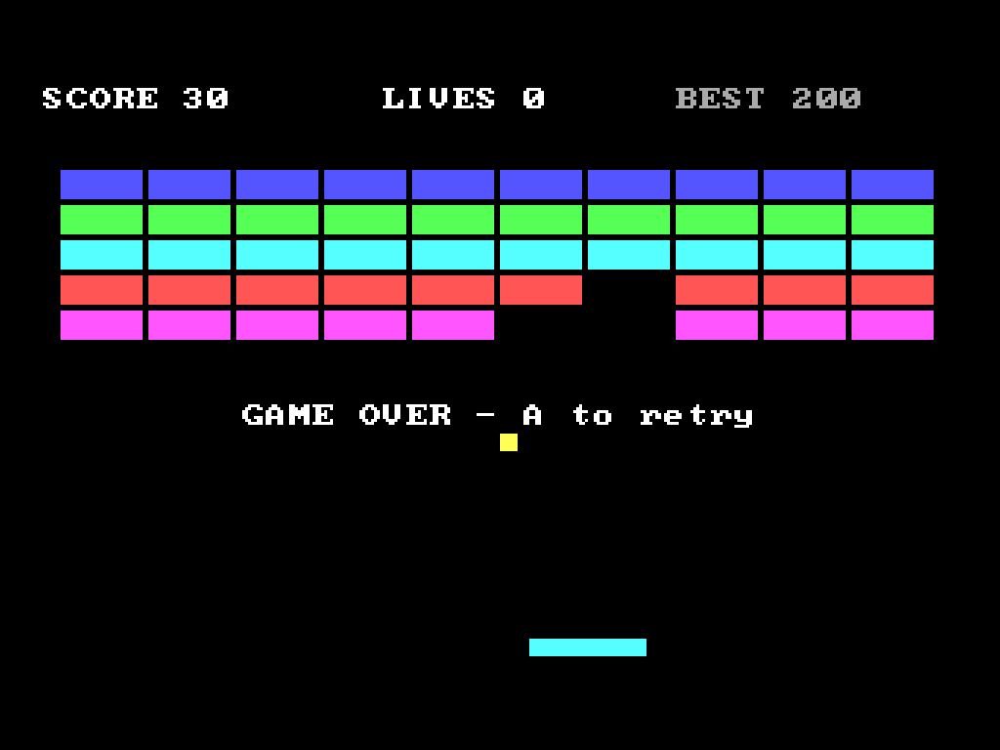

# RingOS

An arcade operating system, written in Rust, where games are written in **Ring**, a tiny language.
Boots from UEFI, shows a gallery of games, and runs them as sandboxed bytecode.
Every game gets a hard **16 KB** budget (file and memory), so a whole arcade fits on the cheapest hardware.

| Breakout | Pong | Snake |
|---|---|---|
|  |  |  |

The whole OS is a 68 KiB kernel; the gallery uses about 72 KB of RAM with six games loaded.
Design notes and measurements are in [`research/`](research/).

    cargo run        # builds target/ringos.img (disk, for USB) and target/ringos.iso (CD, for VMs)
    .\run.ps1        # boots it in VirtualBox

See `SYNTAX.md` for the language and `games/` for examples.

## Boot it
- VirtualBox: `./run.ps1`, or attach `target/ringos.iso` to an EFI-enabled VM.
- Real PC (UEFI, Secure Boot off): write `target/ringos.img` to a USB stick (Rufus "DD image" mode, or `dd`), boot from it.
- Sound uses the PC speaker; high scores live in UEFI NVRAM (`save`/`load` in Ring).
